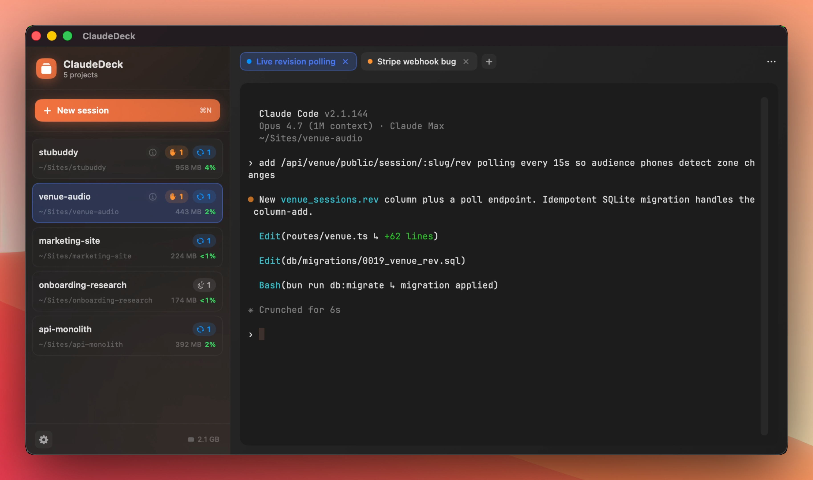
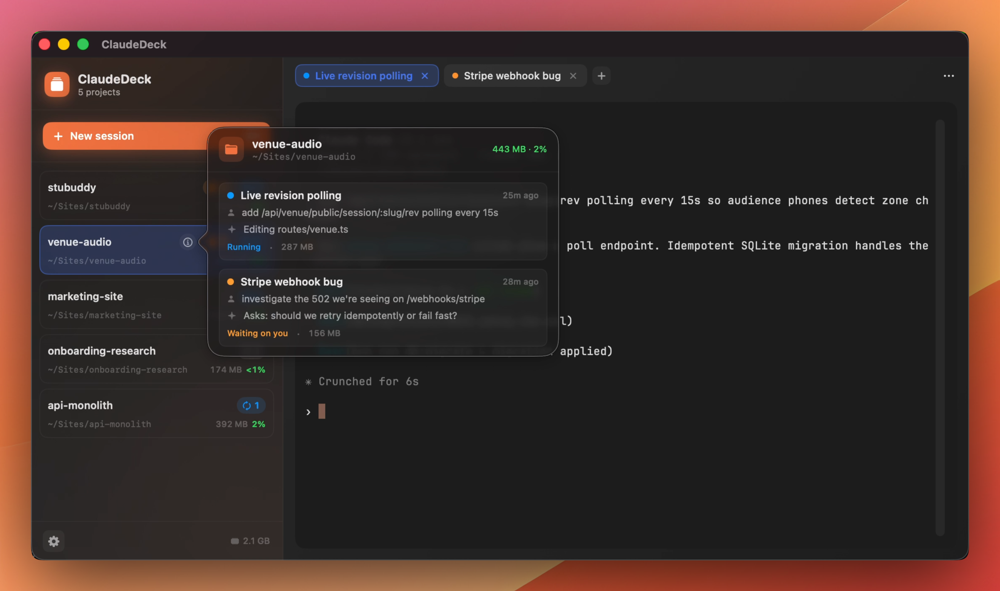

# ClaudeDeck

A native macOS dashboard for [Claude Code](https://claude.com/claude-code) sessions.



ClaudeDeck collapses every Claude Code agent you have running into a single window, grouped by project. You can see at a glance which agents are waiting on you, which are working, and which are eating memory — without tab-switching across Terminal, iTerm, or VS Code instances. Optionally, ClaudeDeck can use the Anthropic API to produce a short title and rolling "what's happening" summary for each agent.



ClaudeDeck spawns and hosts the real `claude` CLI in a built-in terminal pane, so anything you can do in Claude Code from a terminal you can do here. Conversations are saved across launches via `claude --resume`.

> **Important:** the AI features are entirely optional. ClaudeDeck works without an API key — you just won't get the LLM-generated tab titles, narrative summaries, or cross-cutting insights. Everything else (project grouping, status counts, memory tracking, session restoration, etc.) works the same.

## Features

- **Project-level view** — agents in the same working directory collapse into one row, with counts of how many are waiting on you, running, or idle.
- **Memory awareness** — total process RAM per project as a percentage of system memory, color-coded.
- **Session restoration** — on relaunch, ClaudeDeck offers to resume each agent where it left off via `claude --resume`.
- **Save and close** — close an agent now but keep it in the restore queue so the next launch offers to bring it back.
- **Drag-and-drop reordering** — projects in the sidebar and tabs in the strip both reorder by drag; order is persisted.
- **Keyboard shortcuts** — `⌘T` new tab in active project, `⌘⇧S` new session, `⌘W` close tab (with confirmation), `` ⌘` `` cycle next project, `` ⌘⇧` `` cycle next tab in project.
- **⌘-click file paths** — paths Claude prints in the terminal become clickable. Markdown files open in an in-app preview sheet (with table support); anything else reveals in Finder.
- **Transcript viewer** — browse historical JSONL conversations for any project via the per-project three-dots menu; useful for hunting down "what was that command I ran yesterday."
- **Resizable, remembered sidebar** — drag the divider to a width you like; persisted across launches and collapses to an icon rail when narrow.
- **System sleep prevention** — while ClaudeDeck has live agents, your Mac won't fall asleep mid-task. Display can still dim.
- **Lives in the menu bar** — compact dropdown that shows status counts and lets you jump straight to any agent.
- **Optional Claude-powered tab titles** (requires your own Anthropic API key, see below) — a short 2-4 word title is generated once per session after the first real exchange, then locked in.

## Requirements

- macOS 14.0 or later
- Xcode 16 or later (free from the Mac App Store; no Apple Developer Program subscription needed)
- [XcodeGen](https://github.com/yonaskolb/XcodeGen) — `brew install xcodegen`
- [Claude Code](https://claude.com/claude-code) installed and either on your `PATH` or in one of the standard locations ClaudeDeck searches (`/opt/homebrew/bin`, `/usr/local/bin`, `~/.claude/local/claude`, `~/.bun/bin`, `~/.npm-global/bin`).

You do **not** need a paid Apple Developer account to build, run, or use ClaudeDeck — ad-hoc signing is the default and works fine for personal use. The only reason to sign with a developer cert is to stop macOS from re-prompting for keychain access on every rebuild during daily development (see [Optional: signing for daily development](#optional-signing-for-daily-development) below).

## Quick start

```sh
git clone https://github.com/stulogy/claudedeck.git
cd claudedeck
xcodegen generate
open ClaudeDeck.xcodeproj
```

Then build & run from Xcode (⌘R), or from the command line:

```sh
xcodebuild -project ClaudeDeck.xcodeproj -scheme ClaudeDeck -configuration Debug build
open build/Build/Products/Debug/ClaudeDeck.app
```

The `.xcodeproj` is regenerated from `project.yml` by XcodeGen and isn't committed — run `xcodegen generate` again after pulling.

## Configuration

### Without an Anthropic API key (default)

You don't need to configure anything. Click **+ New session**, point ClaudeDeck at a project folder, and it spawns `claude` there. Tabs default to the project name; the sidebar groups agents by project; status counts, memory tracking, session restoration, and every keyboard shortcut all work. The only thing you give up is the LLM-generated tab title.

### With an Anthropic API key

Open **Settings** (⌘,), enter your Anthropic API key, and toggle **Enable LLM summaries** on. After a session has had at least two real user prompts, ClaudeDeck calls `claude-haiku-4-5` once to mint a short 2-4 word tab title and never revises it. There's no other LLM usage — no rolling narratives, no insights, no recurring polls. Cost is roughly one Haiku call per conversation.

**Where the key lives.** ClaudeDeck stores your key in a 0600 plist at `~/Library/Application Support/ClaudeDeck/secrets.plist`. The file is owned by you, only readable by you, and the key never leaves your machine except for direct HTTPS calls to `api.anthropic.com`.

### Optional: signing for daily development

Builds use ad-hoc signing by default. macOS keychain treats each ad-hoc binary as a "different app" and re-prompts for access on every rebuild. If that bothers you, copy the example override file:

```sh
cp Local.xcconfig.override.example Local.xcconfig.override
```

Edit it to set your `DEVELOPMENT_TEAM` and signing identity (see the file for the format). Find your team id with:

```sh
security find-identity -v -p codesigning
```

`Local.xcconfig.override` is gitignored, so your team id stays on your machine.

## How status is inferred

ClaudeDeck reads the JSONL transcripts Claude Code writes to `~/.claude/projects/<escaped-cwd>/<session-uuid>.jsonl` directly — no UI scraping, no accessibility hooks.

| Inferred status | Signal |
|---|---|
| **Waiting on you** | Last entry is an assistant turn with `stop_reason: end_turn` after at least one user prompt |
| **Running** | Last assistant turn has `stop_reason: tool_use` and no matching `tool_result` yet, or a user turn is being processed |
| **Idle** | Brand-new agent with no user prompts yet, or file untouched for more than 5 minutes |
| **Stale** | File untouched for more than 24 hours |

Per-process memory comes from Darwin's `proc_pidinfo` syscall — no entitlements required.

## Demo mode

For screenshots and contribution PRs, launch with `--demo` to skip real session restoration and load a curated fixture set (5 projects, 8 agents, mixed statuses, canned terminal output). No API calls, no `claude` processes spawned.

```sh
open build/Build/Products/Debug/ClaudeDeck.app --args --demo
```

## License

MIT — see [LICENSE](LICENSE).

## Acknowledgements

- [SwiftTerm](https://github.com/migueldeicaza/SwiftTerm) for the embedded terminal.
- Claude Code, obviously.
